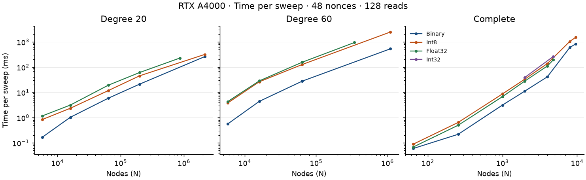
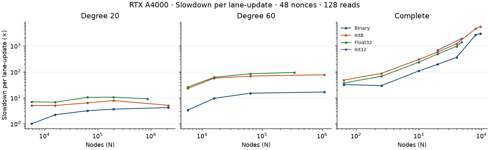

# A4000 capacity and slowdown

The RTX A4000 runs sparse models with more than one million nodes and complete models up to 9,583 nodes with Binary coefficients.
Float32 fits complete models with 4,794 nodes. The limits describe how much fits. The times show how long it runs.

## Test setup

- Card: `NVIDIA RTX A4000`.
- Physical GPU index: 1.
- SM count: 48.
- Container: `quip-solver-cuda-ci`, CUDA 12.9.1.
- Benchmark source revision: `66d4b30574d53209b7ed475fbfc61b29fc8812de`.
- Reads: 128 per nonce. Concurrency: 48 nonces and one nonce.
- Every sweep point uses one warm-up and four measured repeats.
- Default sweep points: 64 and 256, with four sweeps per beta rung.
- Large cells use 8 and 32 sweeps when earlier cells predict more than 15 minutes for 64 and 256.
- Every GPU launch checks for compute processes on GPU 1. Measurements run sequentially.

Raw records, commands, logs, models, and generation scripts:
`/zfspool/quip-mining/bench-evidence/msa-vram-dense/`.
The evidence directory contains `grid.sh`, `run_grid.py`, `manifest.json`, `summary.json`, and `summary.md`.

For each paired repeat, subtract the 64-sweep launch time from the 256-sweep launch time and divide by 192.
Use the median of those four values. Reduced cells divide the 32-minus-8 difference by 24.
This subtraction removes fixed launch costs from the estimate.

Per lane-update time is sweep time divided by N × reads.
Slowdown divides this value by the degree-20 Binary N = 5,791 baseline at the same nonce count.
Throughput is N × reads × nonces divided by sweep time.
Sparse runs use synthetic circulant graphs without node shuffling. Complete graphs and Family B models use the inputs shown in the tables.

## Runtime capacity grid

The corrected probe on 2026-10-26 reports 16,621,961,216 free bytes and 13,297,568,972 usable bytes.
The budget is 277,032,686 bytes per instance. The probe uses 48 instances and 64 beta rungs.
The limits use these values. Free device memory can change between runs.
The corrected footprint includes a 32 MiB session allowance for pool growth on both storage paths.

| Connectivity | Precision | Nodes | Couplers | Storage | Bytes per instance | Slowdown, 48 nonces |
|---|---|---:|---:|---|---:|---:|
| degree 20 | Binary | 2,145,598 | 21,455,980 | spill | 272,399,954 | 4.186× |
| degree 20 | Int8 | 2,145,512 | 21,455,120 | spill | 272,388,936 | 5.109× |
| degree 20 | Int32 | 869,680 | 8,696,800 | spill | 274,727,792 | unknown |
| degree 20 | Float32 | 869,715 | 8,697,150 | spill | 274,739,092 | 9.086× |
| degree 60 | Binary | 1,096,198 | 32,885,940 | spill | 270,669,914 | 16.597× |
| degree 60 | Int8 | 1,096,153 | 32,884,590 | spill | 270,659,039 | 76.852× |
| degree 60 | Int32 | 345,013 | 10,350,390 | spill | 274,539,404 | unknown |
| degree 60 | Float32 | 345,027 | 10,350,810 | spill | 274,550,644 | 94.018× |
| complete | Binary | 9,583 | 45,912,153 | dense | 276,298,944 | 2979.056× |
| complete | Int8 | 9,583 | 45,912,153 | dense | 276,298,944 | 5424.181× |
| complete | Int32 | 4,794 | 11,488,821 | dense | 276,232,232 | 1885.922× |
| complete | Float32 | 4,794 | 11,488,821 | dense | 276,232,232 | 1379.464× |

Each precision applies to both fields and couplings. Int32 also needs 525,056 bytes for integer acceptance tables with 64 beta rungs.
The probe computes an Int32 limit with those tables. Node rounding can give the same complete-model limit for both precisions.
Each instance uses one SM. The limit depends on precision. It also counts reads and beta rungs.

The prior probe used the same memory snapshot. It admitted complete Binary and Int8 models at 9,595 nodes and Float32 at 4,800 nodes.
The corrected limits are 9,583 and 4,794 nodes. The timing tables keep the measured sizes from the prior run.
The calibration endpoints remain those measured sizes. The corrected grid interpolates within that range.

The JSON and text probe logs are in the worktree at
`.superpowers/sdd/2026-10-23-msa-vram-capacity-dense/final-fix-probe-{json,text}.log`.

## Timing and slowdown tables

Each slowdown uses the baseline with the same nonce count. Throughput counts all nonces.
The timing tables list cells that pass. The last section shows all failed cells.
Sweep time is in milliseconds. Throughput is in billions of lane-updates per second.

### Degree 20

| Precision | N | Nonces | Sweeps | Sweep ms | G lane-updates/s | Slowdown |
|---|---:|---:|---|---:|---:|---:|
| binary | 5,791 | 48 | 64/256 | 0.1685 | 211.2075 | 1.000× |
| binary | 16,000 | 48 | 64/256 | 1.0290 | 95.5295 | 2.211× |
| binary | 64,000 | 48 | 64/256 | 5.8894 | 66.7664 | 3.163× |
| binary | 200,000 | 48 | 64/256 | 21.2237 | 57.8975 | 3.648× |
| binary | 2,145,598 | 48 | 64/256 | 261.2550 | 50.4586 | 4.186× |
| binary | 5,791 | 1 | 64/256 | 0.1490 | 4.9760 | 1.000× |
| binary | 16,000 | 1 | 64/256 | 0.5542 | 3.6955 | 1.346× |
| binary | 64,000 | 1 | 64/256 | 3.0609 | 2.6763 | 1.859× |
| binary | 200,000 | 1 | 64/256 | 10.1925 | 2.5117 | 1.981× |
| binary | 2,145,598 | 1 | 64/256 | 110.4232 | 2.4871 | 2.001× |
| int8 | 5,791 | 48 | 64/256 | 0.8438 | 42.1675 | 5.009× |
| int8 | 16,000 | 48 | 64/256 | 2.3463 | 41.8974 | 5.041× |
| int8 | 64,000 | 48 | 64/256 | 11.8031 | 33.3145 | 6.340× |
| int8 | 200,000 | 48 | 64/256 | 45.3375 | 27.1034 | 7.793× |
| int8 | 2,145,512 | 48 | 8/32 | 318.8496 | 41.3425 | 5.109× |
| int8 | 5,791 | 1 | 64/256 | 0.7751 | 0.9563 | 5.203× |
| int8 | 16,000 | 1 | 64/256 | 1.8728 | 1.0935 | 4.550× |
| int8 | 64,000 | 1 | 64/256 | 7.3152 | 1.1199 | 4.443× |
| int8 | 200,000 | 1 | 64/256 | 25.0963 | 1.0201 | 4.878× |
| int8 | 2,145,512 | 1 | 64/256 | 260.6452 | 1.0536 | 4.723× |
| float | 5,791 | 48 | 64/256 | 1.1723 | 30.3516 | 6.959× |
| float | 16,000 | 48 | 64/256 | 3.1372 | 31.3354 | 6.740× |
| float | 64,000 | 48 | 64/256 | 19.2852 | 20.3895 | 10.359× |
| float | 200,000 | 48 | 64/256 | 61.2466 | 20.0632 | 10.527× |
| float | 869,715 | 48 | 64/256 | 229.8657 | 23.2463 | 9.086× |
| float | 5,791 | 1 | 64/256 | 1.0211 | 0.7260 | 6.854× |
| float | 16,000 | 1 | 64/256 | 2.4543 | 0.8344 | 5.963× |
| float | 64,000 | 1 | 64/256 | 9.2790 | 0.8829 | 5.636× |
| float | 200,000 | 1 | 64/256 | 28.9893 | 0.8831 | 5.635× |
| float | 869,715 | 1 | 64/256 | 141.2773 | 0.7880 | 6.315× |

### Degree 60

| Precision | N | Nonces | Sweeps | Sweep ms | G lane-updates/s | Slowdown |
|---|---:|---:|---|---:|---:|---:|
| binary | 5,791 | 48 | 64/256 | 0.5668 | 62.7783 | 3.364× |
| binary | 16,000 | 48 | 64/256 | 4.4134 | 22.2740 | 9.482× |
| binary | 64,000 | 48 | 64/256 | 27.9084 | 14.0895 | 14.990× |
| binary | 1,096,198 | 48 | 8/32 | 529.2424 | 12.7258 | 16.597× |
| binary | 5,791 | 1 | 64/256 | 0.3778 | 1.9620 | 2.536× |
| binary | 16,000 | 1 | 64/256 | 2.3034 | 0.8891 | 5.597× |
| binary | 64,000 | 1 | 64/256 | 8.8332 | 0.9274 | 5.365× |
| binary | 1,096,198 | 1 | 64/256 | 189.1330 | 0.7419 | 6.707× |
| int8 | 5,791 | 48 | 64/256 | 3.8388 | 9.2686 | 22.787× |
| int8 | 16,000 | 48 | 64/256 | 26.3174 | 3.7353 | 56.543× |
| int8 | 64,000 | 48 | 64/256 | 127.2712 | 3.0896 | 68.361× |
| int8 | 1,096,153 | 48 | 8/32 | 2450.5706 | 2.7482 | 76.852× |
| int8 | 5,791 | 1 | 64/256 | 3.1148 | 0.2380 | 20.910× |
| int8 | 16,000 | 1 | 64/256 | 9.7873 | 0.2093 | 23.780× |
| int8 | 64,000 | 1 | 64/256 | 37.1087 | 0.2208 | 22.541× |
| int8 | 1,096,153 | 1 | 8/32 | 578.4967 | 0.2425 | 20.516× |
| float | 5,791 | 48 | 64/256 | 4.3557 | 8.1685 | 25.856× |
| float | 16,000 | 48 | 64/256 | 28.5591 | 3.4421 | 61.360× |
| float | 64,000 | 48 | 64/256 | 156.8195 | 2.5074 | 84.232× |
| float | 345,027 | 48 | 8/32 | 943.6371 | 2.2465 | 94.018× |
| float | 5,791 | 1 | 64/256 | 3.8797 | 0.1911 | 26.044× |
| float | 16,000 | 1 | 64/256 | 9.8788 | 0.2073 | 24.002× |
| float | 64,000 | 1 | 64/256 | 35.2603 | 0.2323 | 21.418× |
| float | 345,027 | 1 | 64/256 | 186.1361 | 0.2373 | 20.972× |

### Complete

| Precision | N | Nonces | Sweeps | Sweep ms | G lane-updates/s | Slowdown |
|---|---:|---:|---|---:|---:|---:|
| binary | 64 | 48 | 64/256 | 0.0599 | 6.5607 | 32.193× |
| binary | 256 | 48 | 64/256 | 0.2189 | 7.1844 | 29.398× |
| binary | 1,000 | 48 | 64/256 | 3.1309 | 1.9624 | 107.627× |
| binary | 2,000 | 48 | 64/256 | 11.2681 | 1.0905 | 193.677× |
| binary | 4,000 | 48 | 64/256 | 41.4454 | 0.5930 | 356.184× |
| binary | 8,000 | 48 | 64/256 | 602.6861 | 0.0816 | 2589.758× |
| binary | 9,595 | 48 | 8/32 | 832.2596 | 0.0708 | 2981.754× |
| binary | 64 | 1 | 64/256 | 0.0598 | 0.1370 | 36.322× |
| binary | 256 | 1 | 64/256 | 0.2065 | 0.1587 | 31.357× |
| binary | 1,000 | 1 | 64/256 | 2.1528 | 0.0595 | 83.690× |
| binary | 2,000 | 1 | 64/256 | 7.6225 | 0.0336 | 148.162× |
| binary | 4,000 | 1 | 64/256 | 40.5727 | 0.0126 | 394.314× |
| binary | 8,000 | 1 | 64/256 | 308.9331 | 0.0033 | 1501.215× |
| binary | 9,595 | 1 | 8/32 | 420.3084 | 0.0029 | 1702.909× |
| int8 | 64 | 48 | 64/256 | 0.0891 | 4.4152 | 47.836× |
| int8 | 256 | 48 | 64/256 | 0.6466 | 2.4324 | 86.832× |
| int8 | 1,000 | 48 | 64/256 | 8.6832 | 0.7076 | 298.496× |
| int8 | 2,000 | 48 | 64/256 | 33.5411 | 0.3664 | 576.507× |
| int8 | 4,000 | 48 | 64/256 | 138.6406 | 0.1773 | 1191.485× |
| int8 | 8,000 | 48 | 8/32 | 1048.4592 | 0.0469 | 4505.257× |
| int8 | 9,595 | 48 | 8/32 | 1515.7612 | 0.0389 | 5430.551× |
| int8 | 64 | 1 | 64/256 | 0.0813 | 0.1007 | 49.395× |
| int8 | 256 | 1 | 64/256 | 0.5351 | 0.0612 | 81.258× |
| int8 | 1,000 | 1 | 64/256 | 6.8225 | 0.0188 | 265.224× |
| int8 | 2,000 | 1 | 64/256 | 32.1846 | 0.0080 | 625.586× |
| int8 | 4,000 | 1 | 64/256 | 125.7049 | 0.0041 | 1221.688× |
| int8 | 8,000 | 1 | 8/32 | 615.0909 | 0.0017 | 2988.943× |
| int8 | 9,595 | 1 | 8/32 | 880.2565 | 0.0014 | 3566.421× |
| float | 64 | 48 | 64/256 | 0.0687 | 5.7257 | 36.888× |
| float | 256 | 48 | 64/256 | 0.5008 | 3.1410 | 67.242× |
| float | 1,000 | 48 | 64/256 | 6.7542 | 0.9097 | 232.184× |
| float | 2,000 | 48 | 64/256 | 28.1670 | 0.4363 | 484.138× |
| float | 4,000 | 48 | 64/256 | 110.6003 | 0.2222 | 950.505× |
| float | 4,800 | 48 | 64/256 | 193.0303 | 0.1528 | 1382.427× |
| float | 64 | 1 | 64/256 | 0.0686 | 0.1195 | 41.642× |
| float | 256 | 1 | 64/256 | 0.4197 | 0.0781 | 63.739× |
| float | 1,000 | 1 | 64/256 | 5.4284 | 0.0236 | 211.030× |
| float | 2,000 | 1 | 64/256 | 23.2921 | 0.0110 | 452.738× |
| float | 4,000 | 1 | 64/256 | 101.2022 | 0.0051 | 983.554× |
| float | 4,800 | 1 | 64/256 | 161.2159 | 0.0038 | 1305.674× |
| int32 | 2,000 | 48 | 64/256 | 39.3046 | 0.3126 | 675.571× |
| int32 | 4,800 | 48 | 64/256 | 263.5757 | 0.1119 | 1887.653× |
| int32 | 2,000 | 1 | 64/256 | 34.5368 | 0.0074 | 671.305× |
| int32 | 4,800 | 1 | 64/256 | 243.9977 | 0.0025 | 1976.118× |

### Real model

| Precision | N | Nonces | Sweeps | Sweep ms | G lane-updates/s | Slowdown |
|---|---:|---:|---|---:|---:|---:|
| float | 98 | 48 | 64/256 | 0.1335 | 4.5088 | 46.843× |
| float | 98 | 1 | 64/256 | 0.1331 | 0.0943 | 52.787× |
| float | 4,794 | 48 | 8/32 | 308.3046 | 0.0955 | 2210.8× |
| float | 4,794 | 1 | 8/32 | 205.0570 | 0.0030 | 1662.8× |

## Int32 dense cost

At N = 2,000, Int32 takes 39.3046 ms per sweep with 48 nonces and 128 reads. This is 3.488× the Binary sweep time at the same N.

At N = 4,800, Int32 takes 263.5757 ms per sweep with 48 nonces and 128 reads.

## Full-card curves

The plots use logarithmic axes and show 48 nonces at 128 reads.
Each point shows a cell that passed. Lines connect measured points.





## Large-model viability

These cells use the runtime node limit, reduced sweep points, or Int32 dense coefficients.
The table also includes cells whose actual wall time exceeds 15 minutes.
Every cell uses 128 reads, one warm-up, and four measured repeats per point.

| Cell | N | Nonces | Sweeps | Wall seconds | Result |
|---|---:|---:|---|---:|---|
| degree-20-binary-m48-n2145598 | 2,145,598 | 48 | 64/256 | 613.4 | pass |
| degree-20-binary-m1-n2145598 | 2,145,598 | 1 | 64/256 | 359.4 | pass |
| degree-20-int8-m48-n2145512 | 2,145,512 | 48 | 8/32 | 388.7 | pass |
| degree-20-int8-m1-n2145512 | 2,145,512 | 1 | 64/256 | 613.6 | pass |
| degree-20-float-m48-n869715 | 869,715 | 48 | 64/256 | 418.3 | pass |
| degree-20-float-m1-n869715 | 869,715 | 1 | 64/256 | 245.3 | pass |
| degree-60-binary-m48-n1096198 | 1,096,198 | 48 | 8/32 | 467.7 | pass |
| degree-60-binary-m1-n1096198 | 1,096,198 | 1 | 64/256 | 601.8 | pass |
| degree-60-int8-m48-n1096153 | 1,096,153 | 48 | 8/32 | 1015.4 | pass |
| degree-60-int8-m1-n1096153 | 1,096,153 | 1 | 8/32 | 438.1 | pass |
| degree-60-float-m48-n345027 | 345,027 | 48 | 8/32 | 248.0 | pass |
| degree-60-float-m1-n345027 | 345,027 | 1 | 64/256 | 329.8 | pass |
| complete-binary-m48-n8000 | 8,000 | 48 | 64/256 | 1371.3 | pass |
| complete-binary-m48-n9595 | 9,595 | 48 | 8/32 | 648.5 | pass |
| complete-binary-m1-n9595 | 9,595 | 1 | 8/32 | 458.6 | pass |
| complete-int8-m48-n8000 | 8,000 | 48 | 8/32 | 613.7 | pass |
| complete-int8-m48-n9595 | 9,595 | 48 | 8/32 | 887.2 | pass |
| complete-int8-m1-n8000 | 8,000 | 1 | 8/32 | 393.2 | pass |
| complete-int8-m1-n9595 | 9,595 | 1 | 8/32 | 545.1 | pass |
| complete-float-m48-n4800 | 4,800 | 48 | 64/256 | 373.6 | pass |
| complete-float-m1-n4800 | 4,800 | 1 | 64/256 | 278.6 | pass |
| complete-int32-m48-n2000 | 2,000 | 48 | 64/256 | 95.1 | pass |
| complete-int32-m48-n4800 | 4,800 | 48 | 64/256 | 583.9 | pass |
| complete-int32-m1-n2000 | 2,000 | 1 | 64/256 | 76.5 | pass |
| complete-int32-m1-n4800 | 4,800 | 1 | 64/256 | 475.1 | pass |
| `family-b-float-m48-n4794` | 4,794 | 48 | 8/32 | 123 | pass |
| `family-b-float-m1-n4794` | 4,794 | 1 | 8/32 | 65 | pass |

## Real portfolio models

Family B draws asset returns from factors fitted to stored price data.
The generator uses the reference `qportfolio` environment. Each size uses one draw with seed 20260930.
The requested sizes are N = 1,000 with K = 333 and N = 4,000 with K = 1,333.

The reference portfolio code caps input holdCount at 100 and mapped cardinality K at 32.
The requested large models fail input validation. N = 99 with K = 33 also fails because the code sets K = 32.
The largest supported size under K = floor(N/3) is N = 98 with K = 32.
That model generated successfully and passed both benchmark concurrency settings. The reference portfolio code remains unchanged.

Temporary packages fill gaps in the reference `qportfolio` environment.

The generator writes a Q matrix. An evidence adapter converts Q with x = (s + 1)/2 before the required `.qmodel` conversion.
The adapter checks energy for four states with known values. It also checks 100 states of the real model.

The data folder keeps all run logs. It also keeps the model archives and the converted `.qmodel` file.
### Family B at the complete Float32 limit

The probe at commit 3125ca4 limits complete Float32 models to N = 4,794. A Family B model at that size uses K = 32, the largest K the reference code accepts.
The reference generator scales as O(N⁴) in `greedy_project`, the cardinality repair it runs on 64 sampled selections. At N = 800 it takes 50 minutes.
The evidence wrapper `famb-fast/fast_generator.py` replaces only that function at run time, with incremental subset scores.
At N = 98, 200, and 400, every array of its output archive matches the reference output exactly. The reference source files match their recorded hashes.
The wrapper generated N = 4,794 in 1,088 seconds. The model has 11,488,821 couplers.
It ran to completion at both concurrency settings with 8/32 sweeps. Its sweep time is 1.6× the synthetic complete Float32 cell at N = 4,800.
The synthetic cell uses ±1 couplings. Real weights give a different acceptance pattern, which this run did not profile.

The converter preserves f64 coefficients in the file. The benchmark real-model entry point evaluates them with Float32.
Mining jobs still need exact coefficients.

## Probe calibration

`src/slowdown_a4000.rs` contains the successful 48-nonce synthetic measurements, generated by the evidence summarizer.
The probe interpolates slowdown linearly in log N within each connectivity and precision series.
Measured endpoints keep their recorded value. Sizes outside the measured range return unknown.
Read counts other than 128 also return unknown.

The output labels the reference as RTX A4000, including when the probe runs on another card.
These curves describe this card and these model types. Other graphs or cards can have other costs.

## Failed cells

The 8,000-node Float32 cells exceed the full-card capacity and fail the memory check.
The memory check reserves 48 instances at both benchmark concurrency settings.
Setting `--nonces 1` does not increase the admitted model size.

### `complete-float-m48-n8000`

Exit 1. Sweeps 64/256. Reads 128.

```text
bench failed: bench device: model with 8000 nodes and 31996000 couplers needs 36899403336 bytes of device memory, but 48 instances leave 13297568972 usable bytes
```

### `complete-float-m1-n8000`

Exit 1. Sweeps 64/256. Reads 128.

```text
bench failed: bench device: model with 8000 nodes and 31996000 couplers needs 36899403336 bytes of device memory, but 48 instances leave 13297568972 usable bytes
```

### `family-b-float-m48-n1000`

Exit 1. Sweeps 64/256. Reads 128.

```text
pydantic_core._pydantic_core.ValidationError: 1 validation error for SliderValues
holdCount
  Input should be less than or equal to 100 [type=less_than_equal, input_value=333, input_type=int]
```

### `family-b-float-m1-n1000`

Exit 1. Sweeps 64/256. Reads 128.

```text
pydantic_core._pydantic_core.ValidationError: 1 validation error for SliderValues
holdCount
  Input should be less than or equal to 100 [type=less_than_equal, input_value=333, input_type=int]
```

### `family-b-float-m48-n4000`

Exit 1. Sweeps 64/256. Reads 128.

```text
pydantic_core._pydantic_core.ValidationError: 1 validation error for SliderValues
holdCount
  Input should be less than or equal to 100 [type=less_than_equal, input_value=1333, input_type=int]
```

### `family-b-float-m1-n4000`

Exit 1. Sweeps 64/256. Reads 128.

```text
pydantic_core._pydantic_core.ValidationError: 1 validation error for SliderValues
holdCount
  Input should be less than or equal to 100 [type=less_than_equal, input_value=1333, input_type=int]
```


The grid has 104 cells: the 100 requested cells and four Int32 cells.
Of the 100 requested cells, 94 passed. Six failed. The four Int32 cells passed.
The two N = 98 Family B cells and the two N = 4,794 Family B cells passed. The tables contain 102 timed cells.
